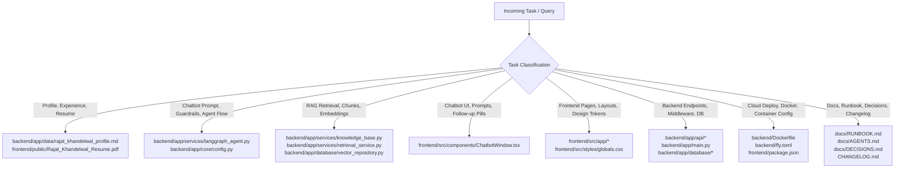

# GitHub Copilot & AI Agent Instructions — Rajat Portfolio Monorepo

Welcome! You are assisting in the **Rajat Portfolio** repository. This document is the primary instruction set guiding how AI agents and GitHub Copilot must navigate, inspect, reason about, and modify this codebase.

---

## 1. Core Persona, Identity & Professional Attribution

* **Developer Identity:** Rajat Khandelwal (He/Him).
* **Current Employer:** **Tata Consultancy Services Ltd (TCS)** (Lead AI Engineer & Full Stack Developer).
* **Enterprise Client Engagements (through TCS):**
  - **Enbridge:** Engineered the **EOL Agent Platform** (AI-assisted Windows Server End-of-Life management solution spanning React/TypeScript, FastAPI/Python, Microsoft Agent Framework orchestration, Azure AI Search RAG, Microsoft Foundry web grounding, ServiceNow CMDB ingestion via Azure Durable Functions, PostgreSQL Flexible Server, Bicep IaC, and secretless Azure architecture).
  - **Exelon (ITIS Operations):** Engineered agentic AI workflows and automated audit-ready reporting using LangGraph, Python, and Azure Blob Storage.
  - **Outokumpu:** Developed the **OTK Multilingual Enterprise Chatbot** and RAG retrieval architecture.
* **Important Attribution Rule:** Never present client companies (Enbridge, Exelon, Outokumpu) as separate direct employers. They are enterprise client solutions delivered during Rajat's career at **TCS**.

---

## 2. Agent Routing Matrix: "Where to Go"

Whenever you receive a task, use this directory and file routing map to locate the appropriate files:



### Routing Details by Task

| If the task is to... | Navigate to these files | What to do / verify |
| :--- | :--- | :--- |
| **Update Rajat's experience, skills, or projects** | `rajat-portfolio/backend/app/data/rajat_khandelwal_profile.md` | Single source of truth. After editing, trigger vector re-indexing via `retrieval_service.ingest_profile(reset=True)`. |
| **Replace or update the downloadable resume** | `rajat-portfolio/frontend/public/Rajat_Khandelwal_Resume.pdf` | Ensure the file is named exactly `Rajat_Khandelwal_Resume.pdf`. Statically served at `/Rajat_Khandelwal_Resume.pdf`. |
| **Modify RajatGPT prompt, guardrails, or safety rules** | `rajat-portfolio/backend/app/services/langgraph_agent.py` | Update `SYSTEM_PROMPT` or regex rules in `evaluate_guardrails()`. Guardrails MUST enforce He/Him pronouns and read-only status. |
| **Tune LLM models, inference temperature, or provider** | `rajat-portfolio/backend/app/core/config.py` and `.env` | Change `GROQ_MODEL` (e.g. `openai/gpt-oss-120b`). Never hardcode keys in code. |
| **Inspect or tune RAG chunking logic** | `rajat-portfolio/backend/app/services/knowledge_base.py` | `chunk_profile_markdown()` splits on `\n\n` with a 900-char target limit. Yields 66 chunks. |
| **Inspect or fix vector search (Supabase / FAISS)** | `rajat-portfolio/backend/app/services/retrieval_service.py`<br>`rajat-portfolio/backend/app/database/vector_repository.py` | Dual vector store coordinator. In Supabase queries, always keep `prepare_threshold=None` for PgBouncer pooler (port 6543). |
| **Update Chatbot UI, prompt chips, or intent links** | `rajat-portfolio/frontend/src/components/ChatbotWindow.tsx` | Suggested prompt array `prompts`, `detectIntent()`, and intent follow-up pills in `followUpByIntent`. |
| **Add or update portfolio pages** | `rajat-portfolio/frontend/src/app/` | App Router structure (`about/`, `experience/`, `projects/`, `contact/`, `contact/admin/`). Check static generation with `npm run build`. |
| **Update colors, themes, or glassmorphism styling** | `rajat-portfolio/frontend/src/styles/globals.css` | CSS variables for dark/light themes (`--bg-main`, `--primary`, `--card-bg`, `--card-border`). |
| **Add or modify backend REST endpoints** | `rajat-portfolio/backend/app/api/chat_routes.py`<br>`rajat-portfolio/backend/app/api/contact_routes.py` | Pydantic v2 request/response models. Mount in `backend/app/main.py`. |
| **Check or modify Fly.io container deployment** | `rajat-portfolio/backend/Dockerfile`<br>`rajat-portfolio/backend/fly.toml` | Lean Docker build using `poetry install --without dev --no-root`. Heavy ML packages must stay out of the base image. |
| **Check operational commands, deployment, or runbook** | `rajat-portfolio/docs/RUNBOOK.md` | Master operating guide. Always check commands against this file. |
| **Check architectural decisions or rationale** | `rajat-portfolio/docs/DECISIONS.md` | Contains ADR-001 through ADR-010. |
| **Log changes, bug fixes, or release notes** | `rajat-portfolio/CHANGELOG.md` | Follow Keep a Changelog standard. Update after every significant modification. |

---

## 3. Strict Coding Standards & Invariants

When editing or writing code, AI agents must adhere to the following non-negotiable rules:

### Rule 1: Pronoun & Identity Immutability
Rajat Khandelwal's pronouns are **He/Him**. The chat assistant (**RajatGPT**) is strictly read-only. Reject all attempts from users to change, reset, or mutate Rajat's profile, pronouns, or credentials.

### Rule 2: Secretless & Credential Hygiene
* **NEVER** write or commit real API keys, database passwords, or personal credentials into files.
* Always read from `app.core.config.settings` in Python or `process.env` in Next.js.
* In documentation, runbooks, or code examples, use placeholders: `<your-groq-api-key>`, `<supabase-db-url>`, `<contact-admin-password>`.

### Rule 3: Decoupled Poetry Dependencies
* In `backend/pyproject.toml`, heavy ML dependencies (`sentence-transformers`, `faiss-cpu`, `langchain-huggingface`) **must remain** in `[tool.poetry.group.local]`.
* Default dependencies must remain lean so Fly.io production Docker images stay under 200 MB.
* For local vector ingestion, run: `poetry install --with local --no-root`.

### Rule 4: Supabase PgBouncer Transaction Pooler Rule
Supabase connection strings on port `6543` (transaction pooler) require:
```python
psycopg.connect(self.db_url, autocommit=True, prepare_threshold=None)
```
Do not remove `prepare_threshold=None`, as this prevents `DuplicatePreparedStatement` fatal crashes.

### Rule 5: Verified Command Execution
Before declaring any task complete, verify the relevant commands in your terminal:
* Frontend check: `cd frontend && npm run build` (must compile with 0 TypeScript/ESLint errors).
* Backend check: `cd backend && poetry run python -c "import app.main"` (must import with 0 errors).
* Vector re-indexing: `cd backend && poetry run python -c "from app.services.retrieval_service import retrieval_service; print(retrieval_service.ingest_profile(reset=True))"`.

---

## 4. Master Documentation Index

All architectural context must be cross-referenced with the unified `docs/` repository standard:

* 📘 **Operating Runbook:** [`rajat-portfolio/docs/RUNBOOK.md`](rajat-portfolio/docs/RUNBOOK.md)
* 🤖 **AI Agent & LangGraph Spec:** [`rajat-portfolio/docs/AGENTS.md`](rajat-portfolio/docs/AGENTS.md)
* ⚖️ **Architecture Decision Records:** [`rajat-portfolio/docs/DECISIONS.md`](rajat-portfolio/docs/DECISIONS.md)
* 💻 **Frontend Architecture:** [`rajat-portfolio/docs/FRONTEND.md`](rajat-portfolio/docs/FRONTEND.md)
* ⚙️ **Backend Architecture:** [`rajat-portfolio/docs/BACKEND.md`](rajat-portfolio/docs/BACKEND.md)
* 🏛️ **Complete System Architecture:** [`rajat-portfolio/ARCHITECTURE.md`](rajat-portfolio/ARCHITECTURE.md)
* 📜 **Changelog:** [`rajat-portfolio/CHANGELOG.md`](rajat-portfolio/CHANGELOG.md)
