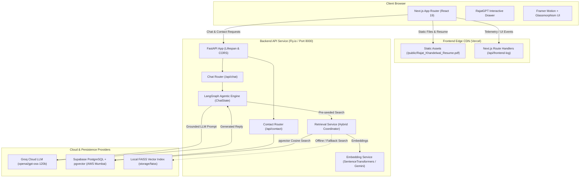

# Complete System Architecture — Rajat Portfolio Monorepo

This document provides a comprehensive, end-to-end architectural breakdown of the **Rajat Portfolio** platform, including both the **Frontend (Next.js)** and **Backend (FastAPI + LangGraph + Vector Search)** subsystems, data flows, database schemas, and cloud deployment pipelines.

---

## 📖 Master Documentation Hub

From now on, all context, architectural decisions, and operational instructions are maintained in this unified documentation suite:

| Document | Description | Target Audience / Use Case |
| :--- | :--- | :--- |
| **[`docs/RUNBOOK.md`](docs/RUNBOOK.md)** | Step-by-step operating guide (setup, local run, ingestion, testing, deployment, troubleshooting) | Daily developer workflows & operational maintenance |
| **[`docs/AGENTS.md`](docs/AGENTS.md)** | RajatGPT agentic architecture, LangGraph state machine, guardrails, tools, and prompts | AI engineering & conversational agent design |
| **[`docs/DECISIONS.md`](docs/DECISIONS.md)** | Architectural Decision Records (ADRs 001–010) explaining key technical choices | Architecture reviews & context rationale |
| **[`docs/FRONTEND.md`](docs/FRONTEND.md)** | Next.js 15 App Router, React 19, Tailwind design tokens, components, and telemetry | Frontend engineers & UI design |
| **[`docs/BACKEND.md`](docs/BACKEND.md)** | FastAPI service architecture, routes, dual vector search, repositories, and dependencies | Backend engineers & cloud ops |
| **[`CHANGELOG.md`](CHANGELOG.md)** | Chronological record of all updates, features, optimizations, and bug fixes | Release management & audit trail |

---

## 1. High-Level System Architecture

The project is structured as a **modern decoupled monorepo** with a Next.js client-facing web application and an asynchronous, agentic FastAPI backend powered by LangGraph, Groq LLM inference, and dual vector storage (Supabase pgvector + local FAISS).



---

## 2. Frontend Subsystem (`frontend/`)

* **Framework:** Next.js 15 (App Router), React 19, TypeScript 5, Tailwind CSS, Framer Motion.
* **Hosting:** Vercel (`https://rajat-portfolio-ten.vercel.app/`).
* **Key Components:**
  - `ChatbotWindow.tsx`: Interactive AI drawer with intent-based suggestion chips and markdown parsing.
  - `ProjectCard.tsx`: Glassmorphism cards with animated hover rails.
  - `/contact/admin`: Password-authenticated submissions viewer.
* *Detailed documentation:* See **[`docs/FRONTEND.md`](docs/FRONTEND.md)**.

---

## 3. Backend Subsystem (`backend/`)

* **Framework:** FastAPI with Python 3.11/3.12, Uvicorn, Poetry.
* **Hosting:** Fly.io (`rajat-khandelwal`, region `sin`).
* **Services:**
  - `knowledge_base.py`: Paragraph-aware chunking yielding **66 grounded chunks**.
  - `retrieval_service.py`: Hybrid search coordinator (Supabase pgvector + FAISS fallback).
  - `vector_repository.py`: Schema management with `prepare_threshold=None` for PgBouncer transaction poolers.
  - `contact_repository.py`: Secure inquiry storage in Supabase PostgreSQL.
* *Detailed documentation:* See **[`docs/BACKEND.md`](docs/BACKEND.md)**.

---

## 4. Agentic RAG Workflow (LangGraph)

* **Architecture:** StateGraph with pre-seeded tool invocation (`seed_tools` -> `tools` -> `agent` -> `final`).
* **Model:** Groq Cloud `openai/gpt-oss-120b` (low latency, temperature 0.2).
* **Guardrails:** Pre-execution regex firewall intercepting pronoun mutations, profile modifications, and prompt injections.
* *Detailed documentation:* See **[`docs/AGENTS.md`](docs/AGENTS.md)**.

---

## 5. Persistence & Vector Schemas

### 5.1 Supabase PostgreSQL Schema
```sql
-- 1. Enable pgvector extension
CREATE EXTENSION IF NOT EXISTS vector;

-- 2. Embeddings Table
CREATE TABLE IF NOT EXISTS rajat_profile_embeddings (
    id BIGSERIAL PRIMARY KEY,
    source TEXT NOT NULL,
    chunk_id INTEGER NOT NULL,
    content TEXT NOT NULL,
    metadata JSONB NOT NULL DEFAULT '{}'::jsonb,
    embedding VECTOR(384) NOT NULL,
    created_at TIMESTAMPTZ NOT NULL DEFAULT NOW()
);

-- 3. Unique Index to allow idempotent upserts
CREATE UNIQUE INDEX IF NOT EXISTS uq_rajat_profile_embeddings_source_chunk
ON rajat_profile_embeddings(source, chunk_id);

-- 4. Cosine Similarity Index
CREATE INDEX IF NOT EXISTS idx_rajat_profile_embeddings_embedding
ON rajat_profile_embeddings
USING ivfflat (embedding vector_cosine_ops)
WITH (lists = 50);

-- 5. Full-Text Search GIN Index for keyword fallback
CREATE INDEX IF NOT EXISTS idx_rajat_profile_embeddings_content_tsv
ON rajat_profile_embeddings
USING gin (to_tsvector('english', content));
```

### 5.2 Contact Submissions Schema
```sql
CREATE TABLE IF NOT EXISTS contact_submissions (
    id BIGSERIAL PRIMARY KEY,
    name TEXT NOT NULL,
    email TEXT NOT NULL,
    company TEXT,
    message TEXT NOT NULL,
    metadata JSONB NOT NULL DEFAULT '{}'::jsonb,
    created_at TIMESTAMPTZ NOT NULL DEFAULT NOW()
);

CREATE INDEX IF NOT EXISTS idx_contact_submissions_created_at
ON contact_submissions(created_at DESC);
```

---

## 6. Operational Execution & Runbook

For verified startup commands, local execution, vector re-indexing, deployment steps, and troubleshooting FAQs, refer directly to:
👉 **[`docs/RUNBOOK.md`](docs/RUNBOOK.md)**
