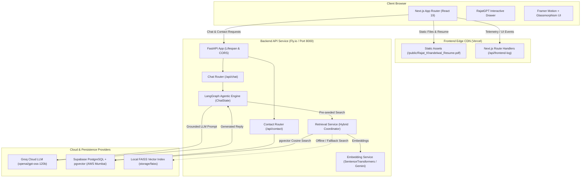
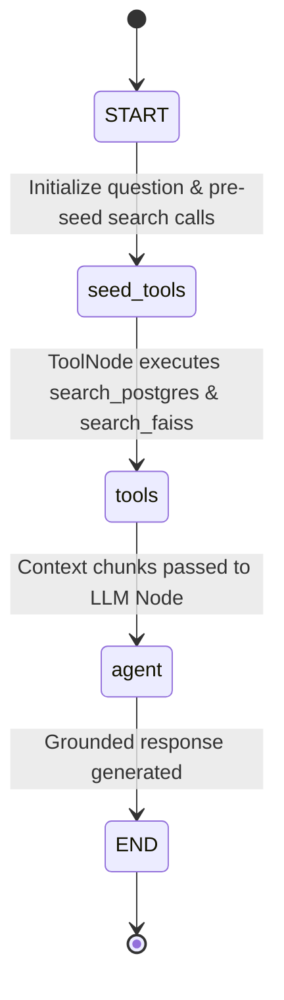

# Complete System Architecture — Rajat Portfolio Monorepo

This document provides a comprehensive, end-to-end architectural breakdown of the **Rajat Portfolio** platform, including both the **Frontend (Next.js)** and **Backend (FastAPI + LangGraph + Vector Search)** subsystems, data flows, database schemas, and cloud deployment pipelines.

---

## 1. High-Level System Architecture

The project is structured as a **modern decoupled monorepo** with a Next.js client-facing web application and an asynchronous, agentic FastAPI backend powered by LangGraph, Groq LLM inference, and dual vector storage (Supabase pgvector + local FAISS).



---

## 2. Frontend Architecture (`frontend/`)

### 2.1 Technology Stack
* **Framework:** Next.js 15 (App Router architecture)
* **Library:** React 19 (Server & Client Components)
* **Language:** TypeScript 5
* **Styling:** Tailwind CSS with CSS Variables & Glassmorphism design tokens
* **Animations:** Framer Motion (page transitions, hover states, chat drawer)
* **Networking:** Axios for HTTP client requests

### 2.2 Directory Structure
```
frontend/
├── public/
│   └── Rajat_Khandelwal_Resume.pdf      # Static downloadable resume served at /Rajat_Khandelwal_Resume.pdf
├── src/
│   ├── app/
│   │   ├── layout.tsx                   # Root HTML layout, font setup, theme providers
│   │   ├── page.tsx                     # Landing / Home screen with Hero, interactive cards, sidebar nav
│   │   ├── about/
│   │   │   └── page.tsx                 # Detailed About page (Background, philosophy, strengths)
│   │   ├── experience/
│   │   │   └── page.tsx                 # Timeline of TCS, Outokumpu, Pepcoding + Resume Download CTA
│   │   ├── projects/
│   │   │   ├── page.tsx                 # Featured project gallery
│   │   │   ├── rag-playground/page.tsx  # Interactive RAG Pipeline deep dive
│   │   │   ├── capstone-enterprise-assistant/page.tsx # Agentic AI platform deep dive
│   │   │   ├── mobikwik-scam-tracker/page.tsx         # Next.js/Supabase tracker deep dive
│   │   │   └── exam-parser-pipeline/page.tsx          # Data parsing project deep dive
│   │   ├── contact/
│   │   │   ├── page.tsx                 # Contact form with backend persistence
│   │   │   └── admin/page.tsx           # Password-protected admin view for contact messages
│   │   └── api/
│   │       └── frontend-log/route.ts    # Server endpoint logging frontend actions to terminal
│   ├── components/
│   │   ├── ChatbotWindow.tsx            # Floating / docked RajatGPT chatbot drawer
│   │   └── ProjectCard.tsx              # Reusable project card with animated hover rails
│   ├── lib/
│   │   ├── api.ts                       # Axios configuration with NEXT_PUBLIC_API_BASE_URL
│   │   └── frontendLogger.ts            # Client-side analytics and error logging bridge
│   └── styles/
│       └── globals.css                  # Theme CSS variables, dark/light modes, scrollbars
├── package.json
└── tsconfig.json
```

### 2.3 Key Frontend Subsystems

#### A. Routing & Navigation
* **Universal Left Rail Navigation:** Persistent across all pages with icons for Home (`home`), About (`person`), Experience (`work`), Projects (`code`), Contact (`mail`), and Chatbot (`smart_toy`).
* **Dual Theme Engine:** CSS variables defined in `globals.css` with a smooth toggle between light and dark modes without layout shift.
* **Resume Download:**
  - Located on `/experience` as a direct `<a download="Rajat_Khandelwal_Resume.pdf" href="/Rajat_Khandelwal_Resume.pdf">` button.
  - Served statically by Next.js from `frontend/public/`.

#### B. RajatGPT Chat Interface (`ChatbotWindow.tsx`)
* State-managed conversational drawer supporting:
  - Markdown message rendering (including clickable links for projects and `/Rajat_Khandelwal_Resume.pdf`).
  - Suggested prompts based on intent (e.g., *"Tell me about Rajat's AI experience"*, *"Can you give me Rajat's resume?"*).
  - Error recovery with user-friendly alerts.
  - Asynchronous event logging to backend `/api/chat/frontend-event`.

---

## 3. Backend Architecture (`backend/`)

### 3.1 Technology Stack
* **Web Framework:** FastAPI (ASGI)
* **Agentic Orchestration:** LangGraph (StateGraph) & LangChain Core
* **LLM Inference:** Groq API (`openai/gpt-oss-120b`)
* **Vector Store & Retrieval:** Supabase PostgreSQL with `pgvector` extension + local FAISS
* **Embeddings:** `sentence-transformers/all-MiniLM-L6-v2` (384-dimensional dense vectors)
* **Database Driver:** `psycopg` 3 with JSONB and pgvector adapter
* **Package & Dependency Manager:** Poetry

### 3.2 Directory Structure
```
backend/
├── app/
│   ├── main.py                          # FastAPI instantiation, CORS, and lifespan management
│   ├── core/
│   │   ├── config.py                    # Pydantic BaseSettings loading .env and ../.env
│   │   └── logging_config.py            # Structured logging setup
│   ├── api/
│   │   ├── chat_routes.py               # /api/chat, /api/chat/ingest, /api/chat/embedding-status
│   │   └── contact_routes.py            # /api/contact, /api/contact/submissions
│   ├── services/
│   │   ├── langgraph_agent.py           # Multi-step Agentic RAG graph with tool execution
│   │   ├── retrieval_service.py         # Dual vector search coordinator (Supabase + FAISS fallback)
│   │   ├── embedding_service.py         # Embedding model wrapper (SentenceTransformer / Gemini)
│   │   ├── knowledge_base.py            # Markdown loader & 900-character paragraph chunker
│   │   └── chat_service.py              # Chat invocation wrapper
│   ├── database/
│   │   ├── vector_repository.py         # Supabase pgvector CRUD & cosine distance search
│   │   └── contact_repository.py        # Supabase contact submissions persistence
│   └── data/
│       └── rajat_khandelwal_profile.md  # Ground truth knowledge base (29 chunks)
├── storage/
│   └── faiss/                           # Serialized local FAISS index files (.faiss + .pkl)
├── scripts/
│   └── check_embedding_status.py        # Diagnostic script for deployed backend embedding probe
├── Dockerfile                           # Production container build definition
├── fly.toml                             # Fly.io deployment configuration
├── pyproject.toml                       # Python package dependencies
└── poetry.lock
```

---

## 4. Agentic RAG Workflow (LangGraph)

The chatbot (`RajatGPT`) uses an agentic architecture rather than a simple one-shot prompt.

### 4.1 State Machine Graph


### 4.2 State Graph Lifecycle
1. **User Request:** `POST /api/chat` receives `{"message": "..."}`.
2. **`_seed_tools_node`:**
   - Injects pre-seeded tool calls into the state message history:
     - `search_faiss(query=state.question)`
     - `search_postgres(query=state.question)`
3. **`ToolNode`:**
   - Executes `retrieval_service.search_postgres` (queries Supabase via pgvector cosine distance).
   - Executes `retrieval_service.search_faiss` (queries local FAISS index).
   - Formats the top-4 chunks with similarity scores into context blocks.
4. **`_agent_node`:**
   - Compiles the system prompt rules:
     - Rule 1: Ground answers strictly in profile knowledge.
     - Rule 2: Admit missing details gracefully without inventing facts.
     - Rule 3: Keep responses concise and professional.
     - Rule 4: Zero fabrication of companies, dates, or achievements.
     - Rule 5: Provide `[Download Rajat's Resume](/Rajat_Khandelwal_Resume.pdf)` for any CV/resume requests.
   - Invokes `ChatGroq(model="openai/gpt-oss-120b", temperature=0.2)`.
5. **Output Delivery:** The resulting answer is returned to the client in JSON format: `{"reply": "..."}`.

---

## 5. Retrieval & Vector Database Subsystem

### 5.1 Document Ingestion & Chunking
* **Knowledge Source:** `app/data/rajat_khandelwal_profile.md`
* **Chunking Algorithm (`chunk_profile_markdown`):**
  - Splits text along paragraph boundaries (`\n\n`).
  - Aggregates paragraphs up to a limit of **900 characters** per chunk.
  - Retains semantic integrity without breaking mid-sentence.
  - Total chunks generated: **29 chunks**.
* **Vector Embeddings:** Generated via `sentence-transformers/all-MiniLM-L6-v2` producing a 384-dimensional dense vector for each chunk.

### 5.2 Supabase PostgreSQL Schema
```sql
-- 1. Enable pgvector extension
CREATE EXTENSION IF NOT EXISTS vector;

-- 2. Embeddings Table
CREATE TABLE IF NOT EXISTS rajat_profile_embeddings (
    id BIGSERIAL PRIMARY KEY,
    source TEXT NOT NULL,
    chunk_id INTEGER NOT NULL,
    content TEXT NOT NULL,
    metadata JSONB NOT NULL DEFAULT '{}'::jsonb,
    embedding VECTOR(384) NOT NULL,
    created_at TIMESTAMPTZ NOT NULL DEFAULT NOW()
);

-- 3. Unique Index to allow idempotent upserts
CREATE UNIQUE INDEX IF NOT EXISTS uq_rajat_profile_embeddings_source_chunk
ON rajat_profile_embeddings(source, chunk_id);

-- 4. Cosine Similarity Index
CREATE INDEX IF NOT EXISTS idx_rajat_profile_embeddings_embedding
ON rajat_profile_embeddings
USING ivfflat (embedding vector_cosine_ops)
WITH (lists = 50);

-- 5. Full-Text Search GIN Index for keyword fallback
CREATE INDEX IF NOT EXISTS idx_rajat_profile_embeddings_content_tsv
ON rajat_profile_embeddings
USING gin (to_tsvector('english', content));
```

### 5.3 Contact Submissions Schema
```sql
CREATE TABLE IF NOT EXISTS contact_submissions (
    id BIGSERIAL PRIMARY KEY,
    name TEXT NOT NULL,
    email TEXT NOT NULL,
    company TEXT,
    message TEXT NOT NULL,
    metadata JSONB NOT NULL DEFAULT '{}'::jsonb,
    created_at TIMESTAMPTZ NOT NULL DEFAULT NOW()
);

CREATE INDEX IF NOT EXISTS idx_contact_submissions_created_at
ON contact_submissions(created_at DESC);
```

### 5.4 PgBouncer Connection Pooler Fix
When connecting to Supabase transaction poolers (port 6543):
* Standard Postgres drivers attempt to create server-side prepared statements (e.g. `_pg3_0`).
* PgBouncer closes or reuses connections across queries, which triggers `DuplicatePreparedStatement` errors.
* **Solution Implemented:** In `vector_repository.py` and `contact_repository.py`, all connections use:
  ```python
  psycopg.connect(self.db_url, autocommit=True, prepare_threshold=None)
  ```
  This disables prepared statements and guarantees 100% stable connection pooling.

---

## 6. Cloud Deployment Pipeline

| Component | Cloud Host | Configuration / Command | Secrets / Env Vars |
| :--- | :--- | :--- | :--- |
| **Frontend** | **Vercel** | Root directory: `frontend/`<br>Build: `npm run build`<br>Output: `.next` | `NEXT_PUBLIC_API_BASE_URL=https://rajat-khandelwal.fly.dev` |
| **Backend** | **Fly.io** | Region: `sin` (Singapore)<br>Config: `backend/fly.toml`<br>Deploy: `fly deploy` | `GROQ_API_KEY`<br>`GROQ_MODEL=openai/gpt-oss-120b`<br>`SUPABASE_DB_URL`<br>`ALLOWED_ORIGINS` |
| **Database** | **Supabase** | Region: `ap-south-1` (Mumbai)<br>Pooler port: `6543`<br>Direct port: `5432` | Managed by Supabase |
| **LLM Inference** | **Groq Cloud** | High-throughput LPU Inference | `GROQ_API_KEY` |

---

## 7. Security & Operational Guardrails
1. **CORS Governance:** Configured dynamically via `ALLOWED_ORIGINS` in FastAPI (`http://localhost:3000` for local dev, portfolio domain in production).
2. **Contact Admin Protection:** Submissions retrieval (`GET /api/contact/submissions`) requires the `X-Admin-Password` header validated against `CONTACT_ADMIN_PASSWORD`.
3. **Graceful Vector Fallback:** If Supabase is paused or unreachable, the retrieval service automatically falls back to local FAISS indexing without crashing the application.
4. **Static CDN Resumes:** The resume file is kept out of database BLOBs and hosted statically in `frontend/public/` to avoid bandwidth costs and signed URL timeouts.
