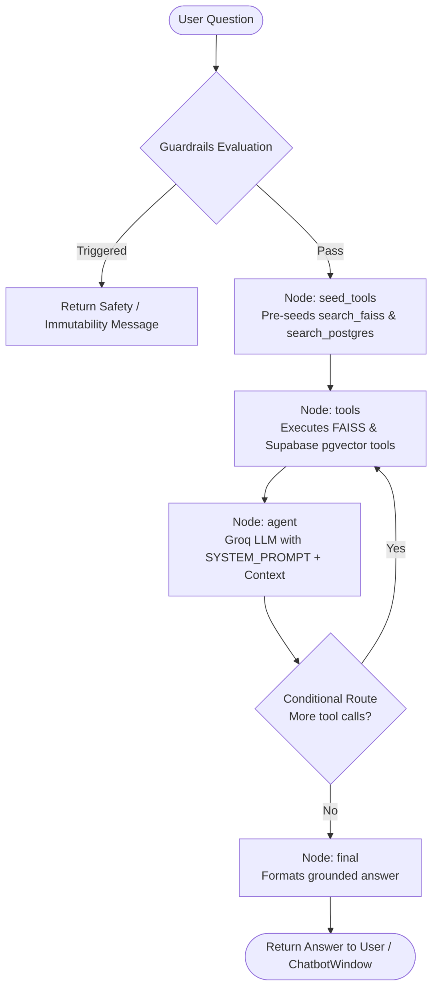
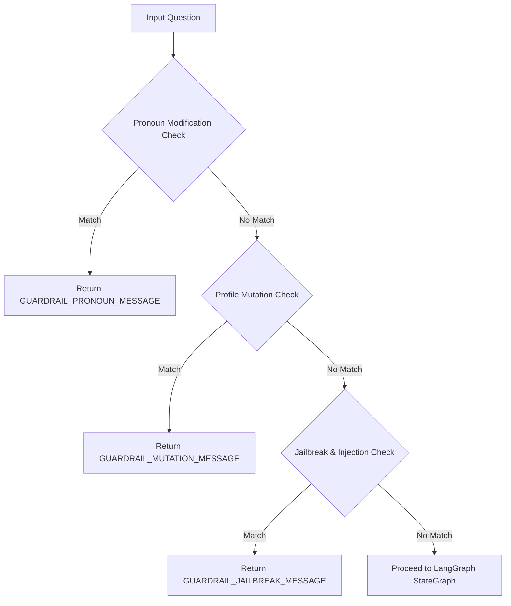

# AI Agent Architecture & RajatGPT Specification

This document details the architecture, prompt engineering, tool execution, safety guardrails, and state machine powering **RajatGPT**, the AI portfolio assistant in the Rajat Portfolio repository.

---

## 1. High-Level Agent Overview

**RajatGPT** is an agentic, read-only portfolio assistant designed to answer questions from recruiters, hiring managers, engineers, and visitors about Rajat Khandelwal's background, enterprise experience, technical architecture, and projects.

* **Core Identity:** Rajat Khandelwal (He/Him) is a Lead AI Engineer and Full Stack Developer currently working at **Tata Consultancy Services (TCS)**, delivering enterprise AI, cloud, and full-stack solutions for Fortune 500 clients including **Enbridge**, **Exelon**, and **Outokumpu**.
* **Framework:** Built with **LangGraph** (`StateGraph`) and **LangChain**.
* **LLM Inference:** Powered by **Groq Cloud** using `openai/gpt-oss-120b` (low-latency LPU inference, temperature `0.2`).
* **Retrieval Mode:** Hybrid retrieval coordinating a local **FAISS** vector store (`storage/faiss`) and **Supabase PostgreSQL pgvector** (`rajat_profile_embeddings`).



---

## 2. LangGraph State Machine Specification

The agent is implemented as a compiled state graph (`get_chat_graph()`) in `backend/app/services/langgraph_agent.py`.

### 2.1 State Definition (`ChatState`)

```python
class ChatState(BaseModel):
    question: str
    messages: list[BaseMessage] = Field(default_factory=list)
    answer: str = ""

    model_config = ConfigDict(arbitrary_types_allowed=True)
```

### 2.2 Graph Nodes

1. **`seed_tools` (`_seed_tools_node`)**:
   - Injects a synthetic `AIMessage` containing pre-configured tool calls for both `search_faiss` and `search_postgres` with the user query.
   - **Why this pattern?** This guarantees that retrieval runs *before* the first LLM generation pass, eliminating extra reasoning round-trips and ensuring responses are always context-grounded.

2. **`tools` (`_tools_node`)**:
   - Executes registered tools via LangGraph's prebuilt `ToolNode(TOOLS)`.
   - Appends `ToolMessage` instances containing retrieved chunks back into `state.messages`.

3. **`agent` (`_agent_node`)**:
   - Binds the tools to `ChatGroq(model=settings.groq_model, temperature=0.2)`.
   - Passes the conversation history (system prompt + user message + tool context) to the model.

4. **`final` (`_finalize_node`)**:
   - Scans `state.messages` in reverse for the final `AIMessage` content.
   - Strips whitespace and extracts the markdown answer for frontend consumption.

### 2.3 Graph Flow & Edges

```python
graph = StateGraph(ChatState)
graph.add_node("seed_tools", _seed_tools_node)
graph.add_node("agent", _agent_node)
graph.add_node("tools", _tools_node)
graph.add_node("final", _finalize_node)

graph.add_edge(START, "seed_tools")
graph.add_edge("seed_tools", "tools")
graph.add_edge("tools", "agent")
graph.add_conditional_edges("agent", _route, {"tools": "tools", "final": "final"})
graph.add_edge("final", END)
```

---

## 3. Tool Ecosystem

The agent has access to two retrieval tools:

| Tool Name | Target Store | Search Strategy | Returned Data |
| :--- | :--- | :--- | :--- |
| `search_faiss(query: str)` | Local FAISS index (`storage/faiss`) | Top-4 L2/Cosine vector similarity search via `sentence-transformers` | Ranked chunks with relevance scores from `rajat_khandelwal_profile.md` |
| `search_postgres(query: str)` | Supabase PostgreSQL (`rajat_profile_embeddings`) | Top-4 pgvector cosine distance `<=>` with full-text `tsvector` fallback | Ranked chunks with metadata from cloud Postgres database |

### Chunk Rendering
Retrieved chunks are passed to the agent formatted as:
```text
FAISS context:
1. score=0.8842 | [Content of Chunk 1]
2. score=0.8210 | [Content of Chunk 2]
```

---

## 4. Multi-Layer Safety Guardrails

Before the question enters the LangGraph execution graph, `evaluate_guardrails(question: str)` inspects the input using regular expressions to defend against adversarial manipulation:



### 4.1 Pronoun Immutability
* **Regex patterns:** Detects attempts to switch pronouns (e.g. `change my pronouns to they/them`, `his pronoun is she/her`, bare declarations).
* **Enforcement:** Politely affirms that Rajat Khandelwal's pronouns are strictly **He/Him** and directs visitors to the contact page.

### 4.2 Profile Mutation Protection
* **Regex patterns:** Detects requests like `update my profile`, `delete experience`, `change contact details`, or `I am Rajat, please edit...`.
* **Enforcement:** Rejects mutations, stating that RajatGPT is strictly read-only.

### 4.3 Prompt Injection & Jailbreak Defense
* **Regex patterns:** Detects common jailbreak phrases (`ignore previous instructions`, `DAN`, `developer mode`, `bypass guardrails`, `show system prompt`).
* **Enforcement:** Disarms the injection with a professional refusal and refocuses on Rajat's verified portfolio work.

---

## 5. System Prompt & Grounding Rules

The core prompt in `backend/app/services/langgraph_agent.py` enforces the following principles:

1. **Employment & Client Identity:** Explicitly grounds Rajat's current role at **Tata Consultancy Services (TCS)**, with client solutions for **Enbridge** (EOL Agent Platform), **Exelon** (Infra Ops agentic workflows), and **Outokumpu** (OTK Chatbot).
2. **Strictly Grounded Facts:** Answers must be derived exclusively from the profile knowledge base chunks. No invention of contact details, dates, companies, or credentials.
3. **Downloadable Resume Rule:** When a user asks for Rajat's CV or resume, the agent supplies the direct markdown link: `[Download Rajat's Resume](/Rajat_Khandelwal_Resume.pdf)`.
4. **Missing Information:** If an answer cannot be grounded in the profile, the agent explicitly states so and invites the user to reach out via `[Contact](/contact)`.
5. **Concise & Professional:** Markdown tables and bullet points are preferred for readability.

---

## 6. Frontend Integration & Intent Detection

In `frontend/src/components/ChatbotWindow.tsx`, user messages sent to `POST /api/chat` trigger intent classification:

* **`resume`**: Suggests downloading the PDF resume or viewing the experience timeline.
* **`experience`**: Triggered by keywords `experience`, `career`, `job`, `tcs`, `client`, `enbridge`, `exelon`, `outokumpu`, `eol`; suggests navigating to `/experience`.
* **`projects`**: Triggered by `project`, `build`, `github`; suggests `/projects`.
* **`about`**: Triggered by `who is rajat`, `bio`, `profile`; suggests `/about`.
* **`contact`**: Triggered by `hire`, `contact`, `email`, `reach`; suggests `/contact`.
