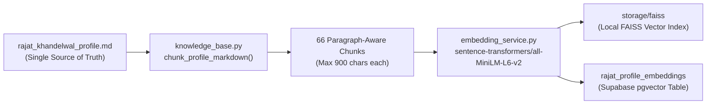

# Backend Architecture & Service Specification

This document details the architecture, REST endpoints, services, repositories, database layer, dependency management, and testing workflows of the **Backend** subsystem in the Rajat Portfolio repository.

---

## 1. Technical Stack

* **Framework:** FastAPI (Python 3.11 / 3.12)
* **ASGI Server:** Uvicorn (standard extras)
* **Package & Dependency Manager:** Poetry
* **Orchestration:** LangGraph (`StateGraph`), LangChain Core, LangChain Community
* **LLM Provider:** Groq Cloud (`langchain-groq`, model `openai/gpt-oss-120b`)
* **Vector Databases:**
  - Local: FAISS (`faiss-cpu`) stored at `storage/faiss`
  - Cloud: Supabase PostgreSQL with `pgvector` extension
* **Relational Database:** PostgreSQL accessed via `psycopg` (v3 with binary extras)
* **Configuration:** Pydantic Settings (`pydantic-settings`) loading `.env`
* **Hosting:** Fly.io (`sin` region, 1 GB RAM shared VM, Docker container)

---

## 2. Directory Structure

```
backend/
├── app/
│   ├── api/
│   │   ├── chat_routes.py               # /api/chat, /ingest, /embedding-status, /frontend-event
│   │   └── contact_routes.py            # /api/contact, /submissions
│   ├── core/
│   │   ├── config.py                    # Settings class reading .env
│   │   └── logging_config.py            # Structured logging setup
│   ├── data/
│   │   └── rajat_khandelwal_profile.md  # Single Source of Truth for portfolio knowledge
│   ├── database/
│   │   ├── supabase_client.py           # Supabase REST client initialization
│   │   ├── vector_repository.py         # pgvector schema, upsert, and similarity queries
│   │   └── contact_repository.py        # contact_submissions schema & persistence
│   ├── services/
│   │   ├── knowledge_base.py            # Profile markdown loader & paragraph-aware chunker
│   │   ├── embedding_service.py         # Embedding provider factory (local, gemini, none)
│   │   ├── retrieval_service.py         # Hybrid search coordinator (FAISS + Supabase)
│   │   ├── chat_service.py              # Bootstrap & chat pipeline orchestrator
│   │   └── langgraph_agent.py           # LangGraph StateGraph, tool definitions & guardrails
│   └── main.py                          # FastAPI application initialization & lifespan
├── scripts/
│   └── check_embedding_status.py        # CLI diagnostic probe for deployed API
├── storage/
│   └── faiss/                           # Local serialized FAISS index files
├── Dockerfile                           # Multi-stage lean production Dockerfile
├── fly.toml                             # Fly.io deployment configuration
├── pyproject.toml                       # Poetry project config (split: base vs. local group)
└── poetry.lock                          # Frozen dependency lockfile
```

---

## 3. REST API Specification

### 3.1 Health & Bootstrap

| Method | Endpoint | Description | Sample Response |
| :--- | :--- | :--- | :--- |
| `GET` | `/health` | Liveness & health check for Fly.io / uptime monitors | `{"status": "ok"}` |
| `GET` | `/bootstrap` | Returns startup initialization details of vector stores | `{"faiss_loaded": true, "auto_ingested": true, "embedding_provider": "local"}` |

### 3.2 Chat & Retrieval (`/api/chat`)

| Method | Endpoint | Description | Request Body | Sample Response |
| :--- | :--- | :--- | :--- | :--- |
| `POST` | `/api/chat` | Primary chat endpoint invoking LangGraph agent | `{"message": "Tell me about your work at Enbridge"}` | `{"reply": "At TCS, Rajat engineered the EOL Agent platform..."}` |
| `POST` | `/api/chat/ingest` | Force re-ingestion and vector re-indexing | `{"reset": true}` | `{"status": "ok", "detail": {"chunks_indexed": 66, "faiss_ready": true}}` |
| `GET` | `/api/chat/embedding-status` | Probes active embedding provider and dimensions | Query: `?probe=test` | `{"resolved_provider": "local", "embedding_dimension": 384}` |
| `POST` | `/api/chat/frontend-event` | Receives client telemetry from Next.js | `{"event": "chat_submit_clicked", "context": {}}` | `{"status": "logged"}` |

### 3.3 Contact Submissions (`/api/contact`)

| Method | Endpoint | Description | Headers / Auth | Request Body |
| :--- | :--- | :--- | :--- | :--- |
| `POST` | `/api/contact` | Submit contact inquiry | None | `{"name": "...", "email": "...", "company": "...", "message": "..."}` |
| `GET` | `/api/contact/submissions` | List submitted inquiries | `X-Admin-Password: <admin_password>` or `?password=<admin_password>` | None |

---

## 4. Knowledge Base & Chunking Architecture



### Chunking Logic (`knowledge_base.py`)
1. Reads markdown file from path specified by `settings.profile_markdown_path`.
2. Splits content by double-newlines (`\n\n`) into semantic paragraphs.
3. Groups adjacent paragraphs up to `chunk_size = 900` characters without breaking sentences.
4. Generates standard LangChain `Document` objects with metadata: `source`, `chunk_id`, and `title`.
5. Current chunk yield: **66 chunks** containing comprehensive details across TCS, Enbridge, Exelon, Outokumpu, RAG Playground, and Capstone projects.

---

## 5. Dual Vector Store & Repositories

### 5.1 `vector_repository.py` (Supabase pgvector)
* **Table:** `rajat_profile_embeddings`
* **Schema:** `id`, `source`, `chunk_id`, `content`, `metadata` (JSONB), `embedding` (VECTOR(384)), `search_vector` (TSVECTOR).
* **Pooler Compatibility:** Uses `prepare_threshold=None` in `psycopg.connect(...)` to prevent prepared statement collisions on Supabase PgBouncer (port `6543`).
* **Search:** Performs cosine distance queries `<=>` with fallback to full-text search (`to_tsquery`) if vector distance fails.

### 5.2 `retrieval_service.py` (FAISS Store)
* **Storage Path:** `storage/faiss/index.faiss` and `storage/faiss/index.pkl`.
* **Resilience:** If Supabase connection fails (e.g. project paused on free tier), FAISS serves local vector queries without interrupting user sessions.

---

## 6. Dependency Decoupling (Poetry)

To avoid shipping multi-gigabyte PyTorch binaries to Fly.io:

```toml
[tool.poetry.dependencies]
# Lean production dependencies (Installed on Fly.io)
python = ">=3.11,<3.13"
fastapi = "^0.115.11"
uvicorn = {extras = ["standard"], version = "^0.34.0"}
langchain = "^0.3.20"
langgraph = "^0.6.11"
langchain-groq = "^0.2.4"
psycopg = {extras = ["binary"], version = "^3.2.12"}

[tool.poetry.group.local]
optional = true
[tool.poetry.group.local.dependencies]
# Heavy ML dependencies (Installed only for local vector ingestion)
langchain-huggingface = "<0.2.0"
sentence-transformers = "^5.2.3"
faiss-cpu = "^1.12.0"
```

---

## 7. Verified Backend Commands

All commands verified on Windows PowerShell:

```powershell
# Navigate to backend directory
cd C:\Users\rajat\OneDrive\Desktop\rajat_portfolio\rajat-portfolio\backend

# 1. Lean install (Default production mode, no heavy ML libraries)
poetry install --no-root

# 2. Local ingestion install (Installs sentence-transformers & faiss-cpu)
poetry install --with local --no-root

# 3. Start development server with hot-reload
poetry run uvicorn app.main:app --reload --host 0.0.0.0 --port 8000

# 4. Trigger profile re-chunking and vector re-indexing via CLI
poetry run python -c "from app.services.retrieval_service import retrieval_service; print(retrieval_service.ingest_profile(reset=True))"

# 5. Run test query against the chat pipeline
poetry run python -c "from app.services.chat_service import generate_chat_response; print(generate_chat_response('Tell me about Rajat\'s work'))"

# 6. Check embedding status probe
poetry run python scripts\check_embedding_status.py --base-url http://localhost:8000
```
