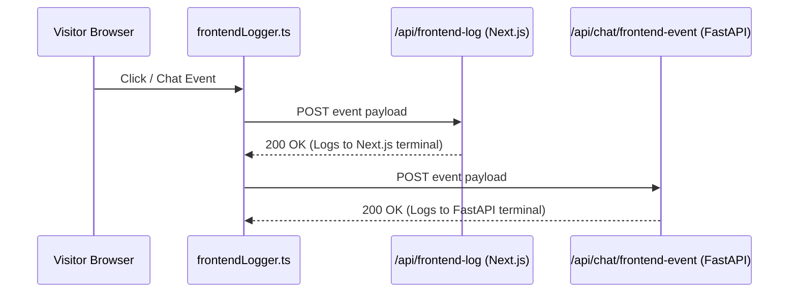

# Frontend Architecture & Component Specification

This document details the architecture, design tokens, routing structure, components, and telemetry pipeline of the **Frontend** subsystem in the Rajat Portfolio repository.

---

## 1. Technical Stack

* **Framework:** Next.js 15 (App Router architecture)
* **Library:** React 19 (Server Components & Client Components)
* **Language:** TypeScript 5
* **Styling:** Tailwind CSS with CSS custom properties & Glassmorphism design tokens
* **Animations:** Framer Motion (page transitions, hover rails, chatbot drawer)
* **HTTP Client:** Axios with centralized base URL configuration
* **Hosting:** Vercel (Edge CDN, automatic HTTPS, branch previews)

---

## 2. Directory Structure

```
frontend/
├── public/
│   ├── Rajat_Khandelwal_Resume.pdf      # Static resume download file
│   └── favicon.ico                      # Application icon
├── src/
│   ├── app/
│   │   ├── layout.tsx                   # Root HTML layout, ThemeContext provider, fonts
│   │   ├── page.tsx                     # Landing / Home screen (Hero, Project cards, Terminal)
│   │   ├── about/
│   │   │   └── page.tsx                 # Detailed About page (Background, philosophy)
│   │   ├── experience/
│   │   │   ├── page.tsx                 # Timeline of TCS & client work + Resume CTA
│   │   │   ├── tcs-agentic-ai/          # Deep dive: ITIS Infra Ops Agentic Workflow
│   │   │   ├── tcs-innovista-user-analysis/ # Deep dive: User Analysis Project
│   │   │   └── tcs-otk-chatbot/         # Deep dive: OTK Chatbot Implementation
│   │   ├── projects/
│   │   │   ├── page.tsx                 # Projects gallery
│   │   │   ├── rag-playground/          # Deep dive: Interactive RAG Pipeline
│   │   │   ├── capstone-enterprise-assistant/ # Deep dive: Agentic Assistant
│   │   │   ├── mobikwik-scam-tracker/   # Deep dive: Community Tracker
│   │   │   ├── exam-parser-pipeline/    # Deep dive: Parser Pipeline
│   │   │   └── portfolio-architecture/  # Deep dive: How This Portfolio Was Built
│   │   ├── contact/
│   │   │   ├── page.tsx                 # Interactive contact form
│   │   │   └── admin/page.tsx           # Password-protected submissions viewer
│   │   ├── resume/
│   │   │   └── page.tsx                 # Dedicated resume viewer & direct download CTA
│   │   └── api/
│   │       └── frontend-log/route.ts    # Next.js server route logging UI telemetry
│   ├── components/
│   │   ├── ChatbotWindow.tsx            # Floating / docked RajatGPT chatbot drawer
│   │   └── ProjectCard.tsx              # Animated glassmorphism project card
│   ├── context/
│   │   └── ThemeContext.tsx             # Theme provider (dark / light mode with localStorage)
│   ├── lib/
│   │   ├── api.ts                       # Axios client configured with NEXT_PUBLIC_API_BASE_URL
│   │   └── frontendLogger.ts            # Client telemetry & error reporting bridge
│   └── styles/
│       └── globals.css                  # Design tokens, CSS variables, glassmorphism utilities
├── package.json
└── tsconfig.json
```

---

## 3. Core Pages & Routes

| Route | Type | Description | Key Interactions |
| :--- | :--- | :--- | :--- |
| `/` | Static (SSG) | Main landing page | Hero greeting, active dock navigation, featured project cards, Ask RajatGPT terminal |
| `/about` | Static (SSG) | Professional biography | Core competencies, architectural philosophy, career journey |
| `/experience` | Static (SSG) | Career timeline | Chronological TCS client roles (Enbridge, Exelon, Outokumpu), downloadable resume CTA |
| `/projects` | Static (SSG) | Full portfolio catalog | Filterable grid of engineering projects with dedicated deep-dive links |
| `/contact` | Static (SSG) | Inquiry form | Name, email, company, and message form with live validation and API submission |
| `/contact/admin` | Client Side | Submissions admin view | Authenticated via `CONTACT_ADMIN_PASSWORD` to review client inquiries |
| `/resume` | Static (SSG) | Resume download hub | Direct download trigger for `/Rajat_Khandelwal_Resume.pdf` |
| `/api/frontend-log` | Dynamic (SSR) | Server logging proxy | Receives client UI click/error payloads and outputs them to the server terminal |

---

## 4. Components Deep Dive

### 4.1 `ChatbotWindow.tsx` (RajatGPT Interface)
* **Message Rendering:** `FormattedMessage` parses markdown headers (`##`, `###`), bullet points (`- `), bold tokens (`**text**`), inline code (`` `code` ``), external links, and resume download tags.
* **Suggested Prompts:**
  - *"Who is Rajat?"*
  - *"Tell me about your work & clients"*
  - *"What is your tech stack?"*
  - *"Are you available for hire?"*
* **Intent-Aware Follow-Up Links (`followUpByIntent`):**
  - Detects query intent (`resume`, `projects`, `experience`, `about`, `contact`, `generic`) and appends contextual action pills under the assistant reply (e.g. `📄 Download PDF Resume`, `View Experience`).
* **Telemetry Hook:** Logs `chat_submit_clicked`, `chat_response_received`, `chat_response_error`, and `chat_prompt_clicked` via `frontendLogger.ts`.

### 4.2 `ThemeContext.tsx` & Design Tokens
Theme switching operates via class injection (`dark` on `document.documentElement`):
* **`--bg-main`:** Dark slate `#0a0f1d` vs. clean light `#f8fafc`.
* **`--primary`:** Electric cyan `#06b6d4` with glowing box-shadows.
* **`--card-bg` / `--card-border`:** Semi-transparent glass backgrounds with subtle 1px border blur.

---

## 5. Telemetry & Client Logging Pipeline



This dual-logging bridge ensures developers running both terminals have real-time visibility into user behavior and UI errors.

---

## 6. Verified Frontend Commands

All commands verified on Windows PowerShell:

```powershell
# Navigate to frontend directory
cd C:\Users\rajat\OneDrive\Desktop\rajat_portfolio\rajat-portfolio\frontend

# Install dependencies
npm install

# Start development server (default port 3000)
npm run dev

# Start development server on alternative port if 3000 is occupied
npm run dev -- -p 3001

# Production build & static page pre-rendering (all 19 routes)
npm run build

# Start production server locally after build
npm run start

# Run ESLint validation
npm run lint
```
